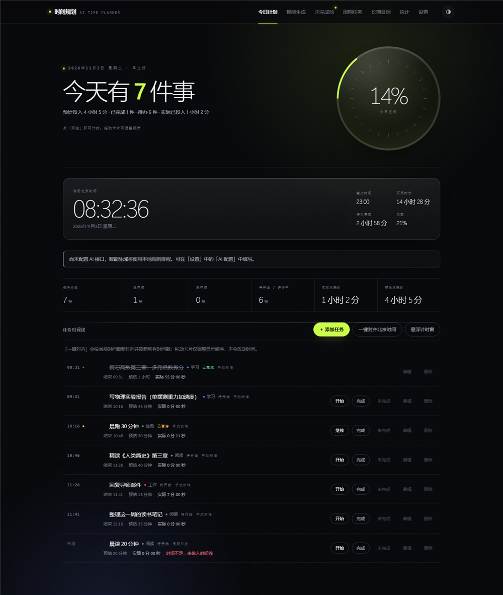
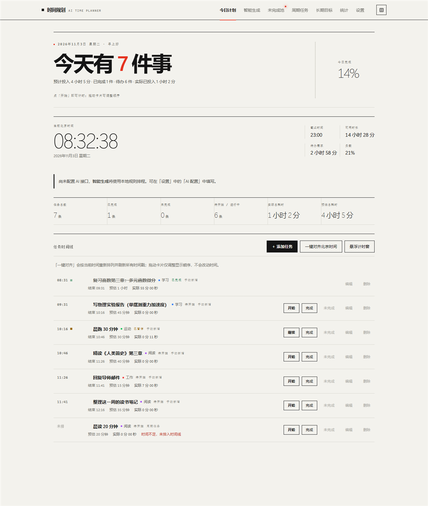
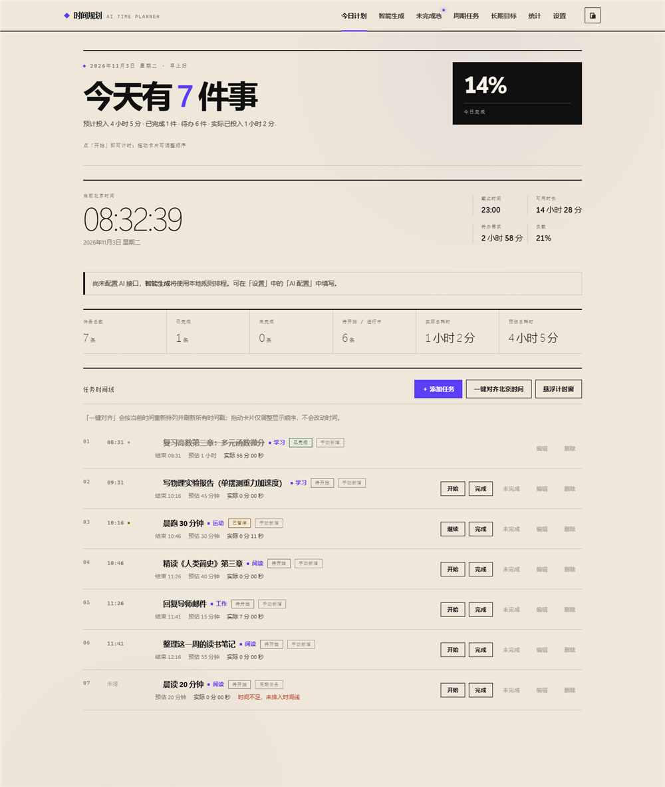

# 时间规划 · AI Time Planner

本地运行、单人使用的 AI 时间规划工具：把一句自然语言变成一张排好时间的计划表，
执行过程中随时暂停、恢复、重排，全程由服务端权威计时，并用「预估 / 实际」的偏差做复盘。

后端 Go + Gin + GORM（SQLite 与 MySQL 双驱动），前端零依赖原生单页应用，**完全离线可用**。
内置三套可即时切换的界面风格，外加一个始终置顶的悬浮计时窗。

<p align="center">
  
  
  
</p>

<p align="center">
  
</p>

---

## 快速开始

### 方式一：SQLite 单文件模式（最省事，推荐先试）

不需要安装任何数据库服务：

```powershell
git clone https://github.com/denglanyimeng/ai-time-planner.git
cd ai-time-planner
copy .env.example .env
$env:DB_DRIVER = 'sqlite'
go run ./cmd/server
```

也可以直接把 `.env` 里的 `DB_DRIVER` 改成 `sqlite`，之后 `go run ./cmd/server` 即可。

数据会写入 `data/planner.db` 单个文件，拷走它即完成备份。

### 方式二：MySQL 模式（默认）

1. **初始化数据库（只需一次）**
   双击 `scripts\init_db.bat`，按提示输入 MySQL 的 root 密码。脚本会：
   - 创建数据库 `ai_time_planner`（utf8mb4）
   - 创建专用账号 `planner_app`（**不使用 root**，权限仅限本库）

   > `init_db.sql` 里的密码是本地示例值，请改成你自己的，并同步写入 `.env`。

2. **确认配置**
   把 `.env.example` 复制成 `.env`，按需修改 `DB_USER` / `DB_PASSWORD` / `DB_NAME`。
   AI 部分可以留空，之后在页面「设置」里填。

3. **启动**

```powershell
.\scripts\goenv.ps1        # 可选：本机沙箱环境需要把 Go 缓存重定向到项目内
go run ./cmd/server
```

浏览器打开 <http://localhost:8080>。

> 首次启动会自动建表并初始化一组默认标签（学习/工作/运动/阅读/生活）。

---

## 技术栈

| 层 | 选型 | 说明 |
|---|---|---|
| 语言 | Go 1.25 | |
| Web 框架 | Gin | |
| ORM | GORM | |
| 数据库 | MySQL 8 **或** SQLite | 时间统一按 UTC 存储，业务日期用 `YYYY-MM-DD` 字符串 |
| 缓存 | Redis（**可选，默认关闭**） | 单用户本地工具，Redis 只做加速，不是运行前提 |
| AI | 任意 OpenAI 兼容接口 | 默认 DeepSeek；未配置时降级为本地规则模式 |
| 前端 | 原生 JS + CSS | 无构建、无 CDN、完全离线 |

---

## 界面与交互

三套风格共用同一份 DOM 和一套 CSS 变量，靠 `data-theme` 切换（右上角一个按钮循环，
选择记在 localStorage，也支持 `?theme=swiss` 这类链接直接指定）：

| 风格 | 特点 |
|---|---|
| **暗场玻璃**（默认） | 近黑底、玻璃面板、青柠色进度弧；大数字用 200 字重压场 |
| **瑞士网格** | 纸白 + 通栏墨线 + 巨号紧排标题，任务是一张真正的表格 |
| **暖色海报** | 米色纸、黑色重体、紫罗兰点缀，任务行挂 01/02/03 编号 |

几个值得一提的细节：

- **悬浮计时窗**：基于 Document Picture-in-Picture（Edge / Chrome 116+）的**始终置顶**小窗，
  可以压在 IDE、文档上面瞥一眼已耗时，也能直接暂停 / 完成；小窗自己走表，
  主标签页切到后台被节流也不会停。不支持该 API 时自动退回普通弹窗。
- **深链**：`#view=stats` 之类的地址可以直接定位到某一页，刷新不丢。
- **首次绘制前定主题**：主题脚本放在 `<head>` 里同步执行，避免先画一帧再变色。
- **减弱动效**：`prefers-reduced-motion` 下所有动画与视差自动关闭。

### 桌面图标（可选）

项目自带一套启动器，可以把「双击图标 → 无控制台黑框 → 浏览器打开」做成桌面快捷方式：

```powershell
powershell -ExecutionPolicy Bypass -File .\tools\install-shortcut.ps1
powershell -ExecutionPolicy Bypass -File .\tools\install-shortcut.ps1 -Startup   # 顺便放进开机启动
```

图标由 `tools/make-icon.ps1` 用 System.Drawing 画出来（想换配色改那里再跑一次）。

---

## 目录结构

```
ai-time-planner/
├── cmd/server/main.go          启动入口：建连、迁移、后台维护、优雅退出
├── internal/
│   ├── planner/                ★ 确定性排程引擎（纯函数，重点单测对象）
│   ├── ai/                     LLM 客户端：结构化草稿生成 + 容错 JSON 解析
│   ├── model/                  数据库实体（显式声明列名）
│   ├── store/                  连接与表结构迁移（MySQL / SQLite 双驱动）
│   ├── config/                 配置加载（环境变量 > .env > 默认值）
│   ├── service/                业务逻辑
│   │   ├── plan.go             生成计划 / 重排 / 对齐 / 拖拽排序
│   │   ├── timing.go           服务端权威计时、心跳结算、每日收尾
│   │   ├── materialize.go      周期任务物化（幂等）+ 未完成任务池
│   │   ├── stats.go            归集、清理、趋势、长期目标进度
│   │   ├── scheduler.go        后台维护协程
│   │   ├── csv.go              CSV 导出 / 无损备份与恢复
│   │   └── secret.go           API Key 加密存储
│   └── api/                    Gin 路由与处理器
├── web/                        前端单页应用
├── scripts/                    建库脚本、Go 环境脚本、端到端验证脚本
├── docs/                       可行性校准报告
└── data/                       运行时生成（SQLite 库、本地密钥等）
```

---

## 关键设计决策

这几条是相对原始需求文档做出的**有意修正**，都是为了让它真的能用。
完整清单见 `docs/可行性校准报告.md`。

### 1. AI 不做时间运算

原文档要求「AI 一键对齐北京时间、刷新全部时间戳」。本项目把职责拆开：

- **AI 只产出结构化草稿**：任务名、标签、预估时长、优先级。prompt 中明确禁止输出任何时间点。
- **时间戳全部由 `internal/planner` 计算**：纯函数、可单测、行为完全确定。

大模型的算术能力不可靠，而排程本身是纯粹的确定性计算——让它算时间只会引入错误，没有任何收益。

### 2. 计时以服务端为权威

前端不做计时器。数据库里只存两个字段：

- `actual_seconds`：已累计秒数
- `run_started_at`：本轮开始时刻（为 NULL 表示未在计时）

任意时刻 `实际耗时 = actual_seconds + (now - run_started_at)`。

原文档的「网页彻底关闭 → 计时停止」在浏览器里**无法可靠实现**：`beforeunload` 不保证触发
（页面崩溃、进程被强杀、移动端切后台都不会触发），后台标签页还会被浏览器节流。
因此改为**正向心跳 + 超时结算**：前端每 30 秒上报一次，超过 90 秒没有心跳，
后台协程就把计时结算到**最后一次心跳时刻**（而不是当前时刻）并暂停任务。

服务重启时同样按最后一次心跳回退结算，避免把停机时间算成学习时长。

### 3. 顺序是权威，时间戳是派生

- 拖拽只修改 `order_index`，**不动时间戳**（遵循原文档规则）。
- 「一键对齐北京时间」按 `order_index` 重新派生全部时间戳。

### 4. 21 天滚动 + 标签汇总永久保留

原文档有一个**硬矛盾**：既要「仅保留最近 21 天数据」，又要「长期目标累计学习时长统计」——
明细删掉之后，累计时长就再也算不出来了。

解决办法是分两层：

- `tasks` 明细：21 天后清理
- `daily_tag_stats` 按标签的每日汇总：**永久保留**，服务端在删除明细前先归集

这样长期目标进度可以无限期累计，同时数据库保持轻量。

### 5. 周期任务是幂等的

原文档要求「每日打开网页自动加载当日周期任务」，但没说幂等性——
用户一天刷新十次页面就会得到十份重复任务。

双保险：物化前先查当日是否已有该任务的实例；数据库层用唯一索引
`(recurring_id, plan_date)` 兜底，并发请求也只会成功一条。

关于「冲突」的定义：原文档没定义，这里固定为**当日已存在同名任务**。
不用「时间重叠」是因为物化发生在排程之前，此刻时间戳还不存在，根本无从判断。

### 6. 未完成任务：只入池，不自动插入次日

原文档自相矛盾（2.1 说「自动归集、次日承接」，3.6 说「可一键加入今日计划」）。

这里选择后者。理由很实际：自动插入会在用户毫无察觉的情况下把第二天直接压到超载，
这与需求本身要求的「超载预警」逻辑正好相悖。

承接采用**复制**而非移动，历史记录保留在原日期不动，这样 21 天趋势统计不会被改写。

### 7. CSV 用于查看，备份用 JSON

原文档要求「导出格式：CSV」且「支持备份文件导入恢复」。但 **CSV 做完整还原是不可靠的**：
无类型信息（分不清空串与 NULL）、Excel 打开再保存会擅自改写日期格式和长数字、跨表关系无从表达。

因此备份包（ZIP）内同时包含：

- `*.csv`：给人看、给 Excel 做分析（带 UTF-8 BOM，中文不乱码）
- `backup.json`：给程序做无损还原

恢复只认 `backup.json`；如果上传的包里没有它，会明确报错而不是尝试用 CSV 凑。

### 8. 时间是「时间块」与「截止时间」的交集

用户自定义时间块（例如 09:00–12:00、14:00–18:00）代表真实可用的时段，
当日截止时间只能在此基础上**收紧**，不能突破时间块的范围。

所以如果你发现延长截止时间后排不下的任务没有回到计划里，请检查时间块是否也需要放宽。

---

## 验证

### 单元测试与集成测试

```powershell
.\scripts\goenv.ps1
go vet ./...
go test ./...
```

覆盖内容：

| 包 | 覆盖重点 |
|---|---|
| `internal/planner` | 排程引擎：排布、顺延、溢出、窗口裁剪与合并、时长收敛、顺序权威性、超载边界 |
| `internal/ai` | 模型响应容错解析（Markdown 围栏、夹带解释、字符串内花括号、截断 JSON）、草稿清洗 |
| `internal/service` | 计时全生命周期、心跳结算、周期任务幂等与冲突、重排状态迁移、归集清理顺序、承接、收尾 |
| `internal/api` | 路由注册无冲突、参数校验、JSON 404 |

集成测试跑在**内存 SQLite** 上，因此无需启动数据库即可运行。

### 端到端验证

先启动服务，然后在另一个终端运行：

```powershell
powershell -ExecutionPolicy Bypass -File .\scripts\check-e2e.ps1
powershell -ExecutionPolicy Bypass -File .\scripts\check-e2e.ps1 -Base http://127.0.0.1:8099
```

脚本会按真实业务流程依次调用 95 项断言并逐项打印结果，结束时自动清理测试数据。

> **注意**：该脚本必须以 **UTF-8 with BOM** 保存。
> Windows PowerShell 5.1 会把无 BOM 的脚本按系统 ANSI 代码页（中文系统为 GBK）解析，
> 导致中文全部乱码、脚本无法运行。同理，脚本内部刻意用 `HttpWebRequest` 而非
> `Invoke-WebRequest`——后者会忽略 `Content-Type` 里的 charset 并同样按 ANSI 解码响应。

---

## 使用说明

首次使用建议顺序：

1. **设置** → 填 AI 接口与 API Key（留空也能用，会降级为本地规则生成）
2. **设置** → 配置时间块（每天可用的时间段，例如 09:00–12:00、14:00–18:00）
3. **智能生成** → 用自然语言描述今天要做的事，可附加本次临时约束
4. **今日计划** → 拖拽调整顺序、逐条开始执行，系统自动计时
5. 遇到突发事务 → **暂停**；处理完 → **继续**（或点「一键对齐北京时间」整体顺延）
6. 当天结束 → 在「统计」里做 AI 效率分析

---

## 已实现 / 待完善

**已实现**

- 任务全字段增删改查、拖拽排序、一键对齐刷新时间戳
- 服务端权威计时：开始 / 暂停 / 继续 / 完成 / 未完成 / 手动修正耗时
- AI 生成计划（含临时约束）、超载预警、AI 规划建议
- 负载计算与溢出任务自动归入未完成池
- 周期任务（每天 / 每2天 / 每3天 / 按星期）+ 冲突覆盖或跳过 + 幂等物化
- 未完成任务池、一键承接
- 标签与配色、时间块、长期目标与累计时长统计
- 21 天趋势、标签排行、AI 效率分析
- CSV 导出、无损备份与恢复、手动清理、批量清空
- 后台维护：心跳结算、逾期归类、每日自动清理、启动追赶
- MySQL / SQLite 双驱动，API Key 加密存储

**待完善**

- 固定时间任务（例如「9 点上课」不允许被重排）—— 目前所有任务都参与排程
- 跨零点的时间块 —— 目前会明确拒绝而不是产生错误窗口
- 计时明细分段（`task_sessions`）—— 目前只存累计秒数，无法回看「今天分几段做的」
- Redis 缓存层 —— 配置项已预留 `REDIS_ENABLED`，业务正确性不依赖它
- 多用户 —— 表结构未加 `user_id`，扩展时需要一次迁移
